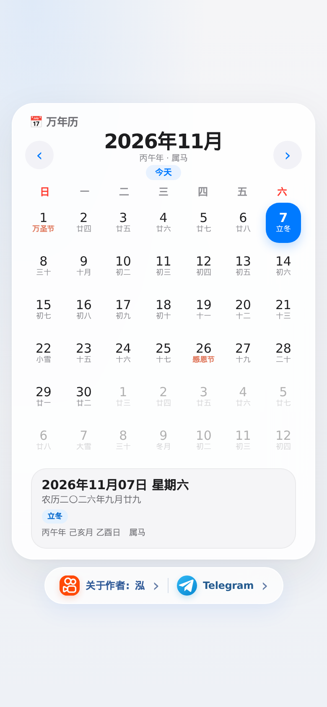

# 📅 易个日历

一个干净的万年历：公历、农历、节气、节日、法定节假日。网页、手机桌面、安卓 App 三处都能用，**全程离线**。



## 用哪个

| | 怎么开始 | 特点 |
| --- | --- | --- |
| **网页** | [www.yigerili.de5.net](https://www.yigerili.de5.net/) | 打开就能用 |
| **装到桌面** | 同上，浏览器菜单 →「添加到主屏幕」 | 全屏、离线、像 App |
| **安卓 App** | [下载 APK](https://github.com/Myfavoriteapril92/yigerili/releases/latest) | 独立安装，不申请任何权限 |

## 功能

- **农历**：农历日期、干支、生肖、节气、传统节日
- **节假日**：法定放假与调休上班标记，内置 2004–2027 数据
- **纪念**：点击 2026 年 10 月 3 日，打开照片与音乐
- **离线**：农历库、节假日、图片、音乐全部打包在本地
- **紧凑一屏**：360×640 起，整页不滚动

## 本地跑

Service Worker 需要 http 环境，不能直接双击 HTML：

```bash
python3 -m http.server 8080
# 打开 http://localhost:8080/
```

不需要安装任何依赖。

## 自检

不开浏览器，直接用 Node 跑一遍核心逻辑：

```bash
node tools/smoke-test.js
```

会检查农历库加载、节假日数据、42 格渲染、干支与节气是否正常。

## 出 APK

推送到 `main` 分支，GitHub Actions 会自动构建，产物在 **Actions → Artifacts**。打 `v*` 标签会自动发布 Release。

本地构建用 Android Studio 打开根目录，或：

```bash
./gradlew assembleDebug
# app/build/outputs/apk/debug/app-debug.apk
```

构建时会把根目录的网页文件复制进 `assets/web/`，所以**网页改了，App 自动跟着改**，不用维护两份代码。

## 目录

```
index.html                 页面骨架
manifest.webmanifest       PWA 清单
sw.js                      Service Worker（离线缓存）
assets/
  css/app.css              全部样式
  js/app.js                全部逻辑（ES5，兼容低版本 WebView）
  js/lunar.js              农历库（本地内置）
  js/chinese-days.js       法定节假日数据（本地内置）
  icons/                   PWA 图标
  images/ music/           照片与音乐
app/                       安卓工程（WebView 外壳）
tools/                     构建与自检脚本
docs/screenshot.png        README 配图
```

## 发布新版本时

`sw.js` 顶部的 `VERSION` 是离线缓存的名字。**改了页面内容就要改版本号**（`ygl-v3` → `ygl-v4`），否则老用户会一直看到缓存里的旧页面。

## 许可

MIT，见 [LICENSE](LICENSE)。
